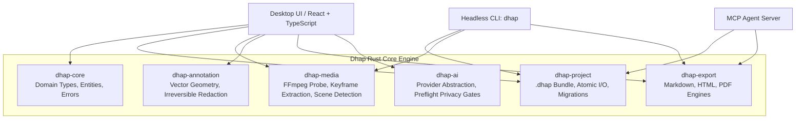

# Dhap (ধাপ) — Architecture Specification

---

## 1. System Overview

Dhap is architected in distinct, decoupled layers. Performance-critical, safety-critical, and persistence operations are implemented as safe Rust crates. The user interface is built as an accessible, responsive desktop application communicating through a typed IPC interface.

---

## 2. Rust Workspace Crates

### `dhap-core`
- **Purpose:** Foundational domain definitions, unique identifiers (ULID/UUID), timestamp representation (`u64` milliseconds), and common error types (`DhapError`).
- **Dependencies:** `serde`, `serde_json`, `thiserror`, `uuid` / `chrono`.
- **Invariants:** Pure data structures and traits. Zero UI or platform GUI dependencies.

### `dhap-project`
- **Purpose:** Manages `.dhap` project bundles (ZIP-based archive containing `manifest.json`, `project.json`, `frames/`, `media/`).
- **Features:**
  - Atomic file write pattern: writes to `.dhap.tmp.<uuid>`, flushes to disk, and renames.
  - Strict path traversal mitigation: rejects `..` or absolute paths on ZIP decompression.
  - Schema migration runner (`schema_version: 1`).
  - Project manifest validation and checksumming.

### `dhap-media`
- **Purpose:** Video inspection and frame extraction engine.
- **Features:**
  - FFmpeg invocation wrapper to probe duration, frame rate, resolution, and codecs.
  - Frame extraction at target timestamps to PNG / WebP.
  - Scene-change heuristic detection: generates candidate keyframe proposals based on frame differential thresholds.
  - Fallback synthetic frame generator for automated headless CI tests.

### `dhap-annotation`
- **Purpose:** Visual annotations and redaction rasterizer.
- **Features:**
  - Vector models: callout badges with numbers, arrows, bounding boxes, circles, highlights.
  - Destructive redactions: solid opaque fills, mosaic pixelation, gaussian blur.
  - In-memory pixel manipulation using the `image` crate. Overwrites pixel buffers destructively so sensitive data cannot be retrieved from exported files.

### `dhap-export`
- **Purpose:** Multi-format documentation generator.
- **Features:**
  - **Markdown Exporter:** Generates GitHub-flavored Markdown with proper relative image paths, table of contents, and callouts.
  - **HTML Exporter:** Self-contained, responsive single-file or folder-based HTML guide with modern typography, keyboard navigation, and embedded CSS.
  - **Print / PDF Layout:** CSS `@media print` styling with page break controls and high-contrast styling.
  - **Preflight Verification:** Validates that all referenced images exist and flags potential unredacted credential patterns.

### `dhap-ai`
- **Purpose:** Optional, privacy-conscious AI assistance.
- **Features:**
  - `AiProvider` async trait (`generate_step_suggestions`, `polish_instruction`).
  - `MockAiProvider` for deterministic testing in CI.
  - Privacy pre-flight disclosure data structure.
  - Zero network calls by default.

### `dhap-cli`
- **Purpose:** Command-line tool for headless automation, CI validation, and scripting.
- **Commands:**
  - `dhap probe <video-path>`
  - `dhap extract-frames <video-path> --interval-ms 2000 --output-dir <dir>`
  - `dhap validate <project-path>`
  - `dhap export <project-path> --format markdown,html --output-dir <dir>`
  - `dhap version`

---

## 3. Storage and Asset Conventions

1. **Relative Paths Only:** Within `project.json`, all media and frame references are relative (e.g. `frames/frame_01H...png`).
2. **Deterministic File Names:** Extracted frames are stored using their entity IDs as names.
3. **No Database Overhead:** For v1.0, the filesystem and JSON metadata suffice. No heavy embedded SQL engine is required, keeping memory footprint low.
